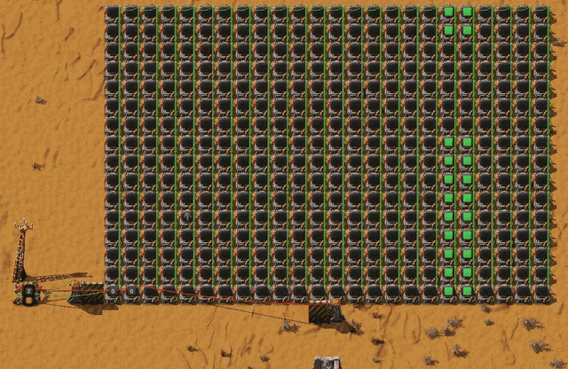
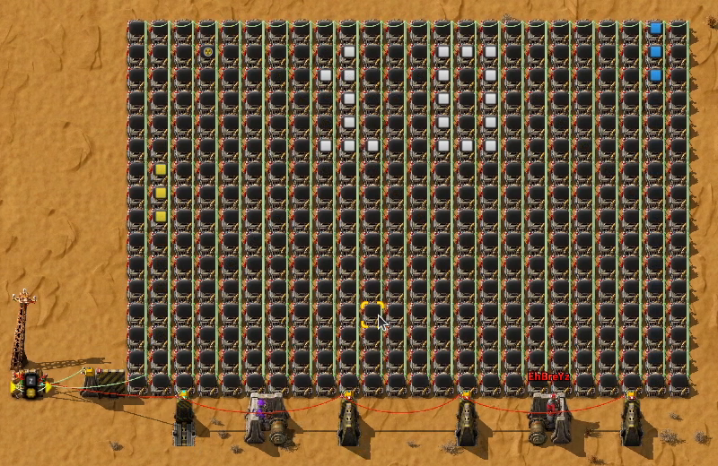

# decider-compiler

Compiles games written in [Fas](https://github.com/fas-language/fas) into a Factorio 2.1 blueprint with one decider combinator that runs the whole game, and display panels for the screen.





## How it works

Every value of every state variable becomes its own on/off flag on a signal, and the combinator's output feeds back into its input. The compiler runs the game's update functions symbolically, works out when each flag should be on in the next tick, and minimizes that into decider conditions. A phase clock keeps it all in sync.

## Usage

`examples/counter.fas` digit goes up each time signal-P is pressed:

```fas
// @state count: 0..9 = 0
// @state held: 0..1 = 0

// @input press = signal-P

// @screen 1x1
// @number count at=0,0

fn update_held(press bool) bool {
    return press
}

fn update_count(count i32, held bool, press bool) i32 {
    if !press || held { return count }

    if count == 9 { return 0 }
    return count + 1
}
```

States are declared with their range and initial value, and each `update_<state>` function computes that state's next value from the states and inputs it names as parameters. `held` remembers last tick's press, so holding the button counts once. See `examples/` for the full games.

```sh
combinator-compiler examples/counter.fas -o out
```

This writes `out/blueprint.txt`. It also prints the condition count and the estimated cost per tick, and stops if the game would run below 20 UPS. See `--help` for the other options.

## Install

You need the [Fas](https://github.com/fas-language/fas/releases/tag/v0.6.3) compiler on your `PATH` (or pass it with `--fas PATH`).

Prebuilt binaries for Linux and Windows are on the [releases page](https://github.com/Globexix/decider-compiler/releases).

To build it yourself, you also need OCaml 5.1+ and dune:

```sh
cd combinator-compiler
opam install . --deps-only
dune build
dune exec combinator-compiler -- ../examples/pong.fas -o out
```
